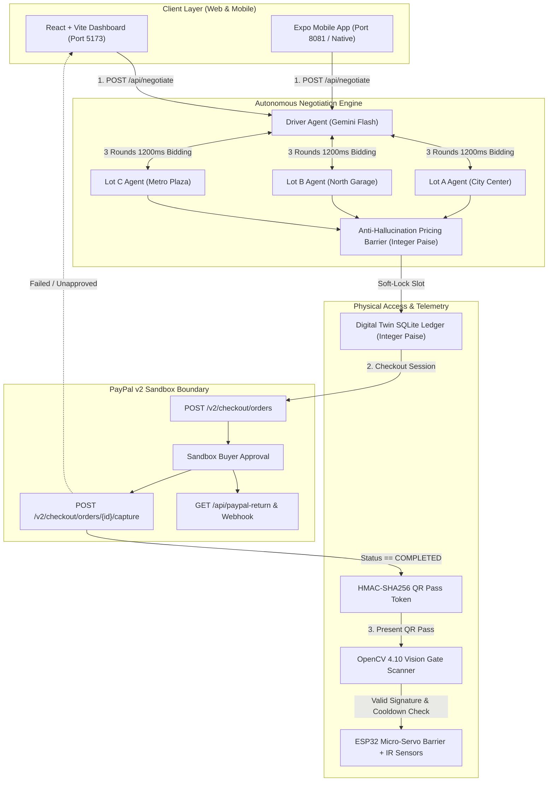

# 🅿️ Agentic Parking Negotiation System with PayPal Settlement & Vision Gate

[](https://opensource.org/licenses/MIT)
[](https://www.python.org/downloads/)
[](https://fastapi.tiangolo.com)
[](https://developer.paypal.com)
[](https://ai.google.dev)
[](https://vitejs.dev)
[](https://expo.dev)

> **Autonomous multi-agent parking rate negotiation with a zero-LLM financial boundary, cryptographically verified PayPal v2 sandbox settlement, and physical servo gate actuation via HMAC-SHA256 signed QR passes.**

---

## 🌟 Overview & Core Innovation

Finding parking in high-demand urban areas forces drivers into rigid, overpriced spot reservations or unpredictable street hunting. This system introduces **autonomous multi-agent bidding** between a driver agent and multiple parking lot agents (powered by Google Gemini), backed by an **uncompromising financial security boundary**:

1. **Autonomous Multi-Agent Negotiation:** A Driver Agent negotiates concurrently across multiple parking garages using private constraints (maximum budget, walking distance penalty, prepay intent). Garage agents bid dynamically based on proximity, live occupancy, and event surges.
2. **Mathematical Invariant Barrier:** AI models are never allowed to touch monetary balances or invent numbers. An anti-hallucination barrier clamps raw LLM bids to hard reserve floors (`base_floor_paise`) and budgets in integer paise (1/100th of an INR).
3. **Cryptographic Payment-to-Gate Bond:** **Zero honor-system.** Access to the physical parking gate is strictly conditional upon verified PayPal v2 capture. Unapproved orders and bypassed confirmation requests are rejected with `HTTP 402 Payment Required`.
4. **Physical Gate & Digital Twin:** Once payment is captured, the backend issues an HMAC-SHA256 signed QR pass. An OpenCV vision scanner verifies the cryptographic signature and actuates an ESP32 micro-servo barrier gate with a 5-second auto-close window.

---

## 🏗️ Architecture



---

## ⚡ Quickstart Guide (1-Minute Setup)

### Prerequisites
- **Python 3.10+**
- **Node.js 18+** & npm
- *(Optional)* ESP32 microcontroller connected via USB serial (`/dev/cu.usbserial-0001`) with servo on pin 18 and IR sensor on pin 19. If no microcontroller is plugged in, the system automatically runs in **Virtual Twin Mode** with full software simulation.

### 1. Clone & Configure Environment
```bash
git clone https://github.com/your-username/agentic-parking-negotiation.git
cd agentic-parking-negotiation

# Copy environment template
cp .env.example .env
```

Edit `.env` if you wish to use live Gemini AI models and real PayPal Sandbox keys:
```env
GEMINI_API_KEY=your_gemini_api_key_here
PAYPAL_CLIENT_ID=your_paypal_sandbox_client_id
PAYPAL_CLIENT_SECRET=your_paypal_sandbox_client_secret
PAYPAL_ENV=sandbox
PAYMENT_MODE=sandbox          # Set to 'mock' for instant zero-config testing
HMAC_SECRET_KEY=dev_hmac_secret_key_change_in_production_32b
ESP32_SERIAL_PORT=             # Leave blank to use virtual hardware twin
FRONTEND_URL=http://localhost:5173
BACKEND_URL=http://localhost:8000
```

### 2. Install Dependencies & Run Backend
```bash
# Python backend dependencies
pip install -r requirements.txt

# Start FastAPI Gateway (Port 8000)
uvicorn backend.main:app --reload --port 8000
```
*The database (`parking.db`) seeds automatically on initial startup.*

### 3. Run Web Dashboard
In a new terminal:
```bash
cd frontend
npm install
npm run dev
```
Open **[http://localhost:5173](http://localhost:5173)** in your browser.

### 4. Run Mobile App (Expo)
In a new terminal:
```bash
cd mobile
npm install
npm run web     # Or `npm run start` for iOS Simulator / Android Emulator / Expo Go
```

---

## 🧪 Running Automated Tests

Run the full automated test suite (17 comprehensive tests including invariant checks, PayPal lifecycle, strict payment bond, and vision gate actuation):

```bash
python3 -m pytest -v backend/tests/
```

### Key Test Coverage:
- `backend/tests/test_invariants.py`: 50 randomized adversarial negotiations proving bids never drop below lot floor rates or exceed driver budgets.
- `backend/tests/test_gate_flow.py`: Verifies QR HMAC lifecycle, slot sensor telemetry, empty-body confirm rejection (`HTTP 400`), uncaptured payment rejection (`HTTP 402`), and `/api/paypal-return` redirect flow.
- `backend/tests/test_payments.py`: Mathematical rupee-to-USD currency conversions, zero-float drift, and live PayPal sandbox API connectivity.
- `backend/tests/test_live_smoke.py`: Live end-to-end multi-agent negotiation with fallback resiliency.

---

## 🔍 How Judges Can Test & Verify

### Step 1: Autonomous Multi-Lot Negotiation
1. Open **[http://localhost:5173](http://localhost:5173)**.
2. Adjust driver parameters in the control panel (Max Budget ₹/hr, Max Walking Distance, Duration).
3. Click **"Start Autonomous Negotiation"**.
4. Observe the **1200ms Paced Dialogue** in the Negotiation Theater:
   - Driver Agent broadcasts opening requests.
   - Parking lot agents (Lot A, Lot B, Lot C) submit counteroffers.
   - Note the **Anti-Hallucination Barrier** clamping whenever an LLM tries to violate reserve floors.
   - The winning lot is soft-locked and declared with exact agreed rates.

### Step 2: Live PayPal v2 Checkout Flow
1. Once a lot is locked, click **"Pay & Get QR Pass"**.
2. **Option A (Real PayPal Sandbox):**
   - Click **"Approve on PayPal Sandbox"**.
   - Log in with any PayPal Sandbox Personal account.
   - Click **"Complete Purchase"**.
   - PayPal redirects to `GET /api/paypal-return`, which captures the payment live.
   - The modal automatically receives the `BOOKING_CONFIRMED` event over WebSocket and displays your signed QR pass!
3. **Option B (Mock Mode / 1-Click Sandbox):**
   - Click **"Confirm Payment & Issue Signed QR Pass"**.
   - The backend verifies order capture and issues the cryptographic pass.

### Step 3: Presenting QR Pass to Physical / Virtual Gate
1. With the QR code displayed, click **"Present to Physical Vision Gate"** (or point your smartphone QR pass at your webcam).
2. The vision scanner scans the token, validates the HMAC-SHA256 signature against the vehicle plate, and actuates the barrier gate:
   - If ESP32 hardware is connected: servo rotates to 90° (OPEN), holds for 5 seconds, and returns to 0° (CLOSED).
   - In Virtual Twin: live status banner and AG Grid display **"ACCESS GRANTED"** with countdown.

### Step 4: Proving Zero Honor-System (Adversarial Security Test)
Verify that payment is a mandatory precondition and cannot be bypassed:

```bash
# 1. Attempt to confirm a pending booking with an empty body (should return 400)
curl -i -X POST http://localhost:8000/api/bookings/any_booking_id/confirm \
     -H "Content-Type: application/json" \
     -d "{}"
# Expected Response: HTTP/1.1 400 Bad Request
# {"detail": "Missing required order_id. Payment must be initiated and approved before confirmation."}

# 2. Attempt to confirm with a fake or unapproved PayPal order ID (should return 402)
curl -i -X POST http://localhost:8000/api/bookings/any_booking_id/confirm \
     -H "Content-Type: application/json" \
     -d '{"order_id": "FAKE_ORDER_999"}'
# Expected Response: HTTP/1.1 402 Payment Required
# {"detail": "Payment capture failed or order not approved by buyer... Gate pass denied."}
```

---

## 📡 API Reference Summary

| Method | Endpoint | Description |
|:-------|:---------|:------------|
| `GET` | `/` | System health, gate state, serial status |
| `GET` | `/api/lots` | List all parking lot policies and rates |
| `GET` | `/api/slots` | Live slot inventory and occupancy states |
| `POST` | `/api/negotiate` | Launch autonomous multi-lot bidding stream |
| `POST` | `/api/bookings/{id}/checkout` | Initialize PayPal v2 order session |
| `POST` | `/api/bookings/{id}/confirm` | Capture order & issue signed HMAC QR pass |
| `GET` | `/api/paypal-return` | PayPal browser approval redirect & live capture |
| `GET` | `/api/paypal-cancel` | PayPal checkout cancellation landing |
| `POST` | `/api/paypal-webhook` | PayPal asynchronous webhook receiver |
| `POST` | `/api/gate/verify-qr` | Scan webcam frame or verify token string |
| `POST` | `/api/hardware/toggle-slot` | Simulate physical IR sensor occupancy toggle |
| `WS` | `/ws` | Live bi-directional event stream & inventory twin |

---

## 📂 Project Structure

```text
├── backend/
│   ├── config.py             # App configuration and environment keys
│   ├── db.py                 # SQLite database and schema initialization
│   ├── llm_client.py         # Google Gemini multi-agent client
│   ├── main.py               # FastAPI application, REST & WebSocket routes
│   ├── orchestrator.py       # 3-round multi-agent negotiation orchestrator
│   ├── payments.py           # PayPal v2 Sandbox provider & HMAC-SHA256 generator
│   ├── pricing_engine.py     # Anti-hallucination mathematical clamping engine
│   ├── serial_bridge.py      # ESP32 serial communication & digital twin
│   ├── vision_gate.py        # OpenCV QR scanner & gate security validator
│   └── tests/                # Automated pytest test suite
├── frontend/
│   ├── src/
│   │   ├── components/       # NegotiationTheater, AgGridDashboard, QRPassModal
│   │   ├── hooks/            # usePacedStream (WebSocket & 1200ms pacing buffer)
│   │   └── App.tsx           # Main dashboard layout
│   └── vite.config.ts        # Vite configuration with /api & /ws reverse proxy
├── mobile/                   # Expo SDK 57 mobile application
│   ├── src/                  # React Native screens, components, and hooks
│   └── package.json
├── hardware/                 # ESP32 Arduino C++ firmware
├── LICENSE                   # Open source MIT License
├── README.md                 # Project documentation
└── requirements.txt          # Python dependencies
```

---

## 📄 License

This project is licensed under the terms of the [MIT License](LICENSE).
